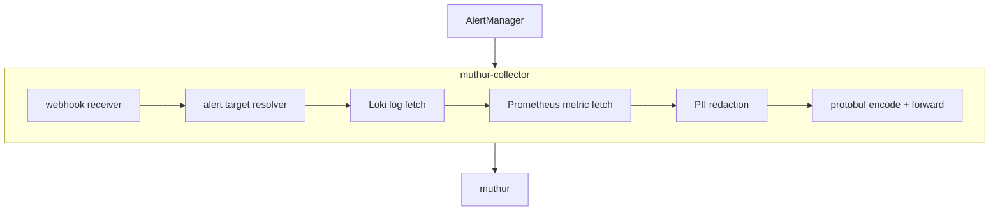

<p align="center">
    
</p>

# muthur-collector

Lightweight Kubernetes alert collector agent. Part of the [muthur](https://github.com/VojtechPastyrik) monitoring system.

Receives AlertManager webhooks, resolves alert targets via the K8s API, fetches logs from Loki, metrics from Prometheus and Kubernetes events for the target objects, redacts PII and credentials, and forwards enriched protobuf payloads to [muthur](https://github.com/VojtechPastyrik/muthur).

<sub>**Keywords:** Kubernetes alert enrichment · AlertManager webhook collector · Loki log + Prometheus metric enrichment · PII / credential redaction · AIOps · SRE · observability · self-hosted.</sub>



## Prerequisites

- Go 1.26+
- protoc + protoc-gen-go
- Helm 3

## Quick start

```bash
make proto
cp .env.example .env
# Edit .env with cluster ID, muthur server URL, and token
make dev
```

## Deploy via Helm

```bash
helm repo add vojtechpastyrik https://vojtechpastyrik.github.io/charts
helm repo update

helm install muthur-collector vojtechpastyrik/muthur-collector \
  --namespace monitoring \
  --set config.clusterId=my-cluster \
  --set config.lokiUrl=http://loki.monitoring.svc:3100 \
  --set config.prometheusUrl=http://prometheus.monitoring.svc:9090
```

## PII redaction (a security boundary)

The redactor runs on every field that leaves the cluster, not just log lines: alert annotations (Summary, Description), label names and values, and metric descriptions all go through the same pattern set as Loki log lines. Categories: email, phone, SSN, addresses, IPv4/IPv6 (including compressed `::1` / `::ffff:` forms), Bearer tokens, JWT, AWS keys, API keys, passwords, credit cards, IBAN, UUID. Custom patterns supported via `REDACT_EXTRA_PATTERNS`.

Redaction is regex-based, so it catches *patterns* — not novel secrets or PII in odd formats. Because it is the one chance to sanitize untrusted text before it reaches the downstream LLM, the size guards **fail closed**:

- A single log line over `REDACT_MAX_LINE_BYTES` (default 8 KiB) is **dropped** — its content is never forwarded raw — because a secret could hide past the region the line-oriented patterns reason about.
- Once the cumulative redacted payload reaches `REDACT_MAX_TOTAL_BYTES` (default 256 KiB), the remaining lines are dropped.
- A single free-text string (annotation, label value, metric description) over 16 KiB is replaced with a `[redacted: string dropped by size guard]` marker so an attacker-controlled annotation cannot push a multi-MB blob past the line-oriented caps.

Replacement counts are exposed as `muthur_collector_redact_replacements_total{surface=log_line|string}` so a drop in either path (e.g. label-value redactions falling to zero after a regex regression) is visible as a metric, not silent. Drops are tracked separately as `muthur_collector_log_lines_dropped_total{reason=oversize|budget|oversize-string}`. The caps can be tuned but not disabled (non-positive values fall back to the defaults).

## Backends

Logs and metrics each come from one of two interchangeable backends, selected independently.

| | `LOGS_BACKEND` | `METRICS_BACKEND` |
|---|---|---|
| default | `loki` | `prometheus` |
| alternative | `victorialogs` | `victoriametrics` |

**VictoriaLogs is a different client, not a different URL.** Its Loki compatibility covers *ingestion* (`/insert/loki/api/v1/push`) and not querying: there is no `/loki/api/v1/query_range`. Reads go to `/select/logsql/query`, speak LogsQL rather than LogQL, and stream newline-delimited JSON objects (`_msg`, `_stream`, `_time`) instead of a wrapped envelope. The one thing both query languages share is the stream selector — `{namespace="…", pod="…"}` is valid in each — so the query the collector builds is textually identical either way.

**VictoriaMetrics is the same protocol.** It serves the same `/api/v1/query_range` with a PromQL superset, so the queries are unchanged. Selecting it adds `AccountID`/`ProjectID` tenant headers and labels enrichment metrics accurately. On a cluster deployment put the tenant in the URL: `http://vmselect:8481/select/0/prometheus`.

### Sharing one backend across clusters

`LOGS_EXTRA_SELECTOR` and `METRICS_EXTRA_SELECTOR` append a label matcher to every query:

```
METRICS_EXTRA_SELECTOR='cluster="prod"'
  → container_memory_working_set_bytes{namespace="x", pod="y", container!="POD", cluster="prod"}
LOGS_EXTRA_SELECTOR='cluster:="prod"'
  → {namespace="x", pod="y"} cluster:="prod"
```

Set them whenever one VictoriaMetrics or VictoriaLogs instance holds several clusters' data. Without them a query for namespace + pod matches an identically-named pod in another cluster, and the alert is enriched with someone else's logs.

## Liveness

The collector beats to the brain every `HEARTBEAT_INTERVAL` (default 60s). The brain declares the cluster down after roughly three missed beats and notifies through its normal receivers.

This exists because a dead collector is otherwise invisible: the alerts it would have forwarded simply never arrive, and the brain cannot tell that from a quiet night. An `absent()` rule inside the monitored cluster does not help — it dies together with the cluster it watches.

On `SIGTERM` the collector drains its HTTP server and sends a final beat marked `shutting_down`, which retires the cluster from the brain's watchdog. Without that, every rollout, node drain and `helm uninstall` would be indistinguishable from a crash and would page someone.

### Proving the alerting path works (`/pipeline-ok`)

A heartbeat only proves the collector process is running — which stays true while Prometheus is crashlooping, while AlertManager drops everything on the floor, and while a bad route sends alerts to a receiver that does not exist. In all three cases the collector looks perfectly healthy and no alert ever reaches you.

kube-prometheus-stack already ships the signal that closes this: the `Watchdog` alert fires continuously by design. Most setups filter it out at AlertManager. Route it to the collector instead:

```yaml
route:
  routes:
    - matchers: [ alertname = "Watchdog" ]
      receiver: muthur-pipeline
      group_wait: 0s
      repeat_interval: 1m

receivers:
  - name: muthur-pipeline
    webhook_configs:
      - url: http://muthur-collector.muthur.svc:8080/pipeline-ok
        send_resolved: false
```

A separate route from `/webhook` on purpose: a Watchdog alert is **never** forwarded to the brain, never reaches the LLM and never costs a token. It fires every minute forever — treating it as an alert would be a permanent, self-inflicted alert storm. The handler only moves a timestamp, which the next heartbeat carries as `pipeline_last_seen`.

The brain then distinguishes two failures that look identical from the outside:

| | collector beats | Watchdog arrives | brain reports |
|---|---|---|---|
| healthy | yes | yes | — |
| alerting path broken | yes | no | `MuthurAlertingPipelineDown` |
| collector or cluster gone | no | — | `MuthurCollectorDown` |

Only a firing alert with the expected `alertname` counts; the name is matched strictly (`PIPELINE_PROBE_ALERTNAME`, default `Watchdog`), because without that check any POST to the path would forge proof that alerting works. Until Watchdog is routed, `pipeline_last_seen` stays 0 and the brain treats the probe as unconfigured — it never alerts about a probe you did not wire up. Arrivals are counted as `muthur_collector_pipeline_probes_total`.

## Query bounds & cost

Enrichment fetches are hard-bounded so an alert storm can't turn into a Loki/Prometheus flood or a giant payload:

- **Logs** — `*_LOOKBACK_MINUTES` time window, `*_MAX_LOG_LINES` line cap (sent as the backend `limit` *and* enforced client-side across pods).
- **Metrics** — a fixed set of queries per target type, `*_LOOKBACK_MINUTES` window, 60s step, first series only.
- **Targets** — at most 10 pods resolved per alert.
- **Kubernetes events** — fetched per target object (resolved pods + PVC) with a server-side field selector, capped at 25 events per object and 50 per payload; event messages go through the same redactor as log lines. A pod stuck in `Pending` has no logs — the reason (`FailedScheduling`, `FailedMount`, unbound PVC, `ImagePullBackOff`) exists only as events.

## Resilience

- **Never wedges AlertManager** — the webhook acks `200` immediately and processes alerts on bounded worker goroutines. Under a storm, alerts over `WEBHOOK_MAX_CONCURRENT` (default 50) are dropped (`muthur_collector_alerts_dropped_total`) rather than spawning unbounded goroutines or blocking the webhook.
- **Forwarding** — retries to muthur with exponential backoff (3 attempts), honours context cancellation during backoff, and drops after the bound. No durable buffer: a multi-minute central outage loses alerts by design rather than backing up.

## Kubernetes RBAC

The ServiceAccount is **read-only** (`get`, `list`) on exactly the resources needed to resolve targets and enrich alerts: pods, namespaces, nodes, PVCs, events, and apps workloads (deployments, daemonsets, statefulsets, replicasets). No `secrets`, no write verbs, no `watch`. It is a ClusterRole (cluster-wide read) because alerts can target any namespace.

## Protobuf contract sync

The `alert.proto` schema is shared with [muthur](https://github.com/VojtechPastyrik/muthur); each repo vendors its own copy. CI runs `make proto-check`, which hashes the schema (ignoring the per-repo `go_package` line) and fails if it drifts from the committed `proto/alert.proto.sha256`. Changing the contract requires `./scripts/check-proto-sync.sh --update` and mirroring the edit + new hash into the sibling repo — the two are released together.

## Configuration (env)

| Env var | Default | Purpose |
|---------|---------|---------|
| `LOGS_BACKEND` | `loki` | `loki` or `victorialogs` — different clients, not interchangeable by URL |
| `METRICS_BACKEND` | `prometheus` | `prometheus` or `victoriametrics` — same query API, different tenancy |
| `LOKI_ENABLED` | `true` | Gates log enrichment whichever backend serves it |
| `LOKI_MAX_LOG_LINES` | `200` | Max log lines fetched per alert |
| `LOKI_LOOKBACK_MINUTES` | `15` | Log time window |
| `PROMETHEUS_LOOKBACK_MINUTES` | `30` | Metric time window |
| `VICTORIALOGS_URL` | `http://victoria-logs-single-server.monitoring.svc:9428` | VictoriaLogs base URL |
| `VICTORIALOGS_MAX_LOG_LINES` | `200` | Max log lines fetched per alert |
| `VICTORIALOGS_LOOKBACK_MINUTES` | `15` | Log time window |
| `VICTORIALOGS_ACCOUNT_ID` / `_PROJECT_ID` | _(empty)_ | Tenant headers; omit on a single-tenant instance |
| `VICTORIAMETRICS_URL` | `http://vmselect.monitoring.svc:8481/select/0/prometheus` | Include the tenant path prefix on a cluster deployment |
| `VICTORIAMETRICS_LOOKBACK_MINUTES` | `30` | Metric time window |
| `VICTORIAMETRICS_ACCOUNT_ID` / `_PROJECT_ID` | _(empty)_ | Tenant headers; needs `-enableMultitenancyViaHeaders` |
| `LOGS_EXTRA_SELECTOR` | _(empty)_ | LogsQL/LogQL filter ANDed into every log query, e.g. `cluster="prod"` |
| `METRICS_EXTRA_SELECTOR` | _(empty)_ | Label matcher ANDed into every metric query |
| `GRAFANA_LOGS_DATASOURCE` | _(matches backend)_ | Datasource name sent to the brain for the Explore deep link |
| `HEARTBEAT_ENABLED` | `true` | Report liveness so the brain can detect this collector going down |
| `HEARTBEAT_INTERVAL` | `60s` | Beat period; the brain's staleness threshold is a multiple of it |
| `PIPELINE_PROBE_ALERTNAME` | `Watchdog` | Alert accepted at `/pipeline-ok` as proof the alerting path delivers |
| `REDACT_MAX_LINE_BYTES` | `8192` | Per-line byte cap; oversize lines dropped (fail closed) |
| `REDACT_MAX_TOTAL_BYTES` | `262144` | Cumulative payload byte budget; excess lines dropped |
| `REDACT_MAX_STRING_BYTES` | `16384` | Per-string cap for non-log fields (annotations, label values, metric descriptions); oversize strings replaced with a fail-closed marker |
| `REDACT_EXTRA_PATTERNS` | _(empty)_ | Extra `name=regex` redaction patterns |
| `WEBHOOK_MAX_CONCURRENT` | `50` | Max alerts processed at once; excess dropped, never blocked |
| `AUTH_MODE` | `mtls` | `mtls` (gRPC, passthrough path) or `signed` (HTTPS through any TLS-terminating edge; see `docs/signed-transport.md`) |
| `SIGNED_TLS_CA_FILE` | _(system roots)_ | Pin the CA of the edge TLS certificate in `signed` mode |

## License

MIT
